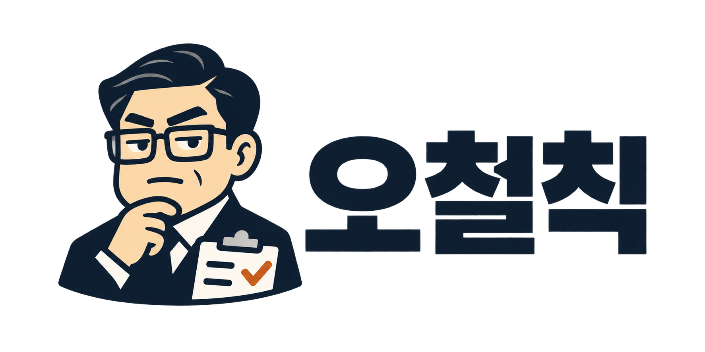
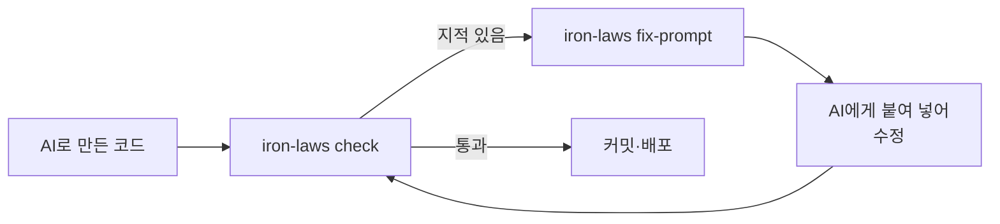

<div align="center">



# 오철칙 (五鐵則) — Iron Laws

**AI가 만든 코드의 보안 결함과 구조 문제를 찾아 주는 점검 도구**  
공공기관 SI 감리에서 자주 지적되는 항목을 AI 개발에 맞춰 점검합니다

[](https://github.com/JinHo-von-Choi/iron-laws/actions/workflows/ci.yml)
[](#라이선스)
[](https://www.python.org/downloads/)

</div>

---

## 어떤 도구인가

AI에게 코드를 시키면 화면이 뜨고 기능이 돌아갑니다. 하지만 AI는 돌아가는 것을 목표로 짜기 때문에 보안과 구조는 빠지기 쉽습니다. 흔한 결과는 이렇습니다.

- API 키가 깃허브에 올라가 요금이 청구되거나 계정을 빼앗깁니다.
- 로그인 없이 누구나 남의 데이터를 보고 지울 수 있는 상태로 배포됩니다.
- 오류가 나도 기록이 없어 원인을 찾지 못합니다.
- 같은 일을 하는 함수가 파일마다 따로 있어서 하나를 고치면 다른 곳이 깨집니다.

오철칙은 프로젝트 폴더를 읽고 이런 문제를 찾습니다. 하는 일은 세 가지입니다.

1. **찾습니다.** 보안 결함과 함께 하드코딩된 키·주소, 삼킨 예외, 중복 함수, 타입 검사 회피, 인증 없는 관리 API, 커밋된 `.env`, 모듈 순환 참조를 봅니다.
2. **쉬운 말로 설명합니다.** "SQL Injection(CWE-89)" 대신 "화면에서 받은 값이 DB 명령에 그대로 섞이면 공격자가 데이터를 빼내거나 지울 수 있습니다"처럼 씁니다. 지적마다 왜 위험한지와 고치는 방법이 붙습니다.
3. **AI에게 고치게 합니다.** `iron-laws fix-prompt`가 찾은 문제를 심각도 순으로 모아, AI 코딩 도구에 붙여 넣을 수정 지시문을 만듭니다.



점검 결과는 행정안전부 「소프트웨어 개발보안 가이드」 49개 항목에 맞춰 정리할 수 있습니다. 다만 공식 인증 도구도, 감리 증빙도 아닙니다. 개발 중 사전 점검에 쓰십시오.

## 설치

Python 3.12 이상이 필요합니다. 파서가 패키지에 들어 있어서 네트워크 없이 동작합니다.

```bash
uv tool install git+https://github.com/JinHo-von-Choi/iron-laws.git
# 또는
pip install git+https://github.com/JinHo-von-Choi/iron-laws.git
```

## 처음 써 보기

점검할 프로젝트 폴더에서 실행합니다.

```bash
iron-laws check .          # 점검. HIGH 이상 지적이 있으면 종료코드 1
iron-laws fix-prompt .     # 코딩 AI에게 붙여 넣을 수정 지시문
```

지적 하나를 더 자세히 보려면 규칙 ID를 넣습니다.

```bash
iron-laws explain IL-501
```

필요할 때 쓰는 명령입니다.

| 하고 싶은 일 | 명령 |
|---|---|
| 행안부 49개 항목별 보고서 | `iron-laws audit . --format markdown -o report.md` |
| GitHub Code Scanning에 올리기 | `iron-laws audit . --format sarif -o iron-laws.sarif` |
| 취약한 의존성 찾기 | `iron-laws deps . --advisory-db ./osv` |
| 프로젝트 구조 진단 | `iron-laws architecture .` |
| 기존 지적은 두고 새로 생긴 것만 보기 | `iron-laws baseline create .` 후 `iron-laws check . --baseline .iron-laws-baseline.json` |
| 설정 파일 만들기 | `iron-laws init` |

명령 전체와 종료코드, 설정 방법은 [사용법](docs/USAGE.md)에 있습니다.

## 코딩 에이전트와 함께 쓰기

Claude Code, Codex CLI, Cursor에서 에이전트가 파일을 고칠 때마다, 그리고 작업을 끝내기 전에 자동으로 점검하게 할 수 있습니다. 지적이 남아 있으면 에이전트가 끝내지 못합니다. MCP 서버로 점검을 도구처럼 부르게 할 수도 있습니다.

Claude Code는 플러그인 하나로 둘 다 켭니다.

```bash
claude plugin marketplace add JinHo-von-Choi/iron-laws
/plugin install iron-laws --marketplace JinHo-von-Choi/iron-laws
```

Codex·Cursor 설정과 MCP 서버는 [에이전트 연결](docs/AGENT_INTEGRATION.md)에 있습니다.

## 무엇을 점검하나

| 분류 | 내용 |
|---|---|
| 행안부 49개 항목 | SQL·명령어·경로 삽입, XSS, SSRF, 하드코딩된 비밀, 취약 암호, 오류 처리 등 |
| AI 코드 보정 | 노출된 비밀, 커밋된 `.env`, Supabase·Firebase 접근 규칙, 의존성 오타, 남의 데이터 접근 |
| 구조 | 큰 함수·파일, 계층 위반, 순환 의존, 중복 함수 |
| AI 에이전트 공격면 | 규칙 파일에 숨긴 지시, MCP 설정의 위험, LLM 응답을 검증 없이 실행하는 코드 |
| 성능, 타입 안전성 | 반복 안의 DB 조회, `any`와 `type: ignore` |

Python, JavaScript/TypeScript, Java, C#, Go, PHP는 입력이 어디서 어디로 흘러가는지까지 따라갑니다. 규칙 목록과 지원 언어, 한계는 [점검 영역과 한계](docs/RULES.md)에 있습니다.

## 더 알아보기

| 문서 | 내용 |
|---|---|
| [사용법](docs/USAGE.md) | 명령, 종료코드, 설정, 지적 억제, CI 연결, 보고서 |
| [에이전트 연결](docs/AGENT_INTEGRATION.md) | 훅, MCP 서버, 플러그인, 지침 파일 |
| [의존성 점검](docs/DEPENDENCIES.md) | 취약한 의존성, SBOM, 존재하지 않는 패키지 이름 |
| [구조 진단](docs/ARCHITECTURE.md) | 구조 지표, 계층 계약 |
| [프로젝트에 맞추기](docs/CUSTOMIZATION.md) | 사내 함수를 알려 주는 사용자 명세, 교훈 기록 |
| [점검 영역과 한계](docs/RULES.md) | 규칙 분류, 지원 언어, 알려진 한계 |
| [패치 검증과 승인 기록](docs/PATCH_VERIFICATION.md) | AI 수정본 검증, 회귀시험, 승인 |
| [보고서 모순 검사](docs/EVIDENCE_VERIFICATION.md) | 보고서가 서로 맞는지 확인하는 항목 |
| [보고서 형식](docs/REPORT_FORMATS.md) | 보고서·기록 파일 형식과 호환 정책 |
| [정확도](docs/ACCURACY.md) | 측정 방법과 결과 |
| [지원 현황](docs/SUPPORT_MATRIX.md) | 규칙×언어별 구현·시험 현황 |
| [오탐·미탐 제보](docs/COUNTEREXAMPLES.md) | 제보 처리 절차 |
| [변경 이력](CHANGELOG.md) | 버전별 변경 |
| [기여 안내](CONTRIBUTING.md) | 개발 환경과 기여 방법 |

## 5대 철칙

| 번호 | 철칙 | 원칙 |
|:---:|:---|:---|
| 제1철칙 | 타협과 묵인은 없다 | 하드코딩된 시크릿, 취약 암호, 꺼 둔 인증서 검증 같은 결함에 "일정이 급해서"라는 변명은 받지 않는다. |
| 제2철칙 | 근거 규정 없는 지적은 잡담이다 | 모든 지적은 행안부 항목 번호와 결합하고, 근거가 없으면 자체 규칙임을 밝힌다. |
| 제3철칙 | 병신같이 덮지 않는다 | 삼킨 예외, 꺼 둔 테스트, 항상 통과하는 인증, 타입 검사 회피를 지적한다. |
| 제4철칙 | 대안 없는 비판은 직무유기다 | 모든 지적에 고치는 방법과 AI용 수정 지시문을 제공한다. |
| 제5철칙 | 전수 검증의 원칙 | 입력 경로를 추적하고 구조·중복·순환 의존까지 점검하며, 점검하지 못한 항목은 숨기지 않는다. |

## 참고 문서

점검 항목은 작성자의 SI 감리 경험을 바탕으로 정했고, 항목 번호는 아래 공개 문서를 참고해 붙였습니다.

- 행정안전부 「소프트웨어 개발보안 가이드」(2021.11): 공공데이터포털 이용허락범위 제한 없음, 한국인터넷진흥원 게시본은 공공누리 제1유형(출처표시). 항목 번호·명칭과 CWE 대응만 데이터로 옮겼고 본문과 예제 코드는 넣지 않았습니다.
- 국가정보원 「국가 사이버보안 기본지침」 제13조제2항 누출금지정보 항목명(국가사이버안보센터 공개 문서).

오철칙은 위 기관의 공식 도구가 아니며 승인이나 보증을 받지 않았습니다. 기관 로고와 명의를 쓰지 않습니다. 이용 조건은 기관이 바꿀 수 있으며, 이 내용은 법률 자문이 아닙니다.

## 라이선스

오철칙은 이중 라이선스입니다.

- **오픈소스:** [GNU AGPL v3](LICENSE). 수정한 버전을 네트워크 서비스로 제공하면 그 소스코드를 같은 조건으로 공개해야 합니다.
- **상용:** AGPL 조건을 따를 수 없으면 [상용 라이선스](LICENSE-COMMERCIAL.md)를 받으십시오.

Copyright (c) 2026 Jinho Von Choi (최진호)

---

<p align="center">
  Made by <a href="mailto:jinho.von.choi@nerdvana.kr">Jinho Choi</a> &nbsp;|&nbsp;
  <a href="https://buymeacoffee.com/jinho.von.choi">Buy me a coffee</a>
</p>
