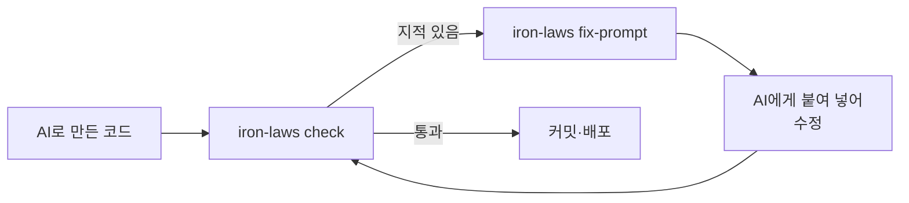
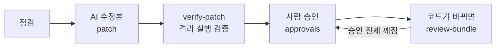

<div align="center">


# 오철칙 (五鐵則) — Iron Laws

**AI로 만든 프로젝트가 보안 사고와 유지보수 지옥이 되기 전에 잡아 주는 점검 도구**  
대기업·공공기관 SI 감리에서 자주 지적되는 항목을 AI 시대에 맞게 정리했습니다

[](https://github.com/JinHo-von-Choi/iron-laws/actions/workflows/ci.yml)
[](https://opensource.org/licenses/MIT)
[](https://www.python.org/downloads/)

</div>

---

## 왜 만들었나

요즘은 개발을 배우지 않은 사람도 AI와 함께 서비스를 만듭니다. 화면이 뜨고 기능이 돌아가면 "완성"처럼 보입니다. 하지만 AI는 **돌아가는 결과물**을 목표로 코드를 짜기 때문에 보안과 구조는 뒷전이 되기 쉽습니다. 만드는 사람에게는 무엇이 위험한지, 무엇이 나중에 발목을 잡을지 알아볼 기준이 없습니다.

결과는 대개 이렇습니다.

- API 키가 깃허브에 올라가 요금 폭탄이나 계정 탈취를 당한다.
- 로그인 없이 누구나 남의 데이터를 보고 지울 수 있는 상태로 배포된다.
- 오류가 나도 아무 기록이 없어 원인을 찾을 수 없다.
- 같은 일을 하는 함수가 파일마다 따로 있어서 하나를 고치면 다른 곳이 깨진다.
- 기능을 덧붙일수록 코드가 뒤엉켜 AI도 사람도 손을 못 댄다.

저는 대기업과 공공기관의 SI 프로젝트에서 감리를 받으며 감리자가 코드에서 무엇을 먼저 보는지 오래 겪었습니다. 오철칙은 그 경험을 정리해 **전문 감리자가 없는 환경의 AI 개발자**가 같은 눈높이로 자기 프로젝트를 점검하게 만든 도구입니다.

## 무엇을 해 주나

**1. 찾아냅니다.**  
보안 결함과 함께 AI가 자주 남기는 습관도 봅니다. 코드에 박아 넣은 주소·키·경로, 로그 없이 삼킨 예외, 여러 파일에 흩어진 중복 함수, `any`와 `type: ignore`로 덮은 타입, 인증 없는 관리 API, 접근 규칙이 없는 Supabase·Firebase, 커밋된 `.env`, 모듈 순환 참조를 점검합니다. 반복문 안의 DB 조회·인터넷 요청, 데이터가 늘면 급격히 느려지는 중첩 반복, AI 코딩 도구 규칙 파일에 숨긴 지시, 취약점이 알려진 의존성 버전, 프로젝트 전체의 구조 상태도 봅니다.

**2. 쉬운 말로 설명합니다.**  
"SQL Injection(CWE-89)" 대신 "화면에서 받은 값이 그대로 DB 명령에 섞이면 공격자가 데이터를 빼내거나 지울 수 있습니다"라고 씁니다. 지적마다 왜 위험한지와 어떻게 고치는지가 붙습니다.

**3. AI에게 고치게 합니다.**  
`iron-laws fix-prompt`는 찾은 문제를 심각도 순으로 모아 AI 코딩 도구에 **그대로 붙여 넣을 수 있는 수정 지시문**을 만듭니다. 지시문에는 "오류를 조용히 삼키지 않는다", "비밀을 코드에 쓰지 않는다", "이미 있는 함수를 다시 만들지 않는다" 같은 수정 원칙도 들어갑니다.



> 작성자의 SI 감리 경험을 바탕으로 만든 점검 도구이며, 공식 인증 도구나 감리 증빙이 아닙니다. 개발 중 사전 점검과 개선에 쓰십시오.

---

## 설치

```bash
# uv 권장
uv tool install git+https://github.com/JinHo-von-Choi/iron-laws.git

# 또는 pip
pip install git+https://github.com/JinHo-von-Choi/iron-laws.git
```

파서가 패키지에 들어 있어 네트워크 없이 동작합니다. Python 3.12 이상이 필요합니다.

## 빠른 시작

```bash
iron-laws check .                          # 점검. HIGH 이상 지적이 있으면 종료코드 1
iron-laws fix-prompt .                     # 코딩 AI에게 붙여 넣을 수정 지시문
iron-laws audit . --format markdown -o report.md     # 행안부 49개 항목별 점검 현황 보고서
iron-laws audit . --format sarif -o iron-laws.sarif  # GitHub Code Scanning용 SARIF
iron-laws explain IL-501                   # 규칙 하나를 쉬운 말로 설명
iron-laws rules                            # 규칙 목록
iron-laws coverage                         # 행안부 49개 항목 중 무엇을 점검하는지
iron-laws deps . --advisory-db ./osv       # 잠금 파일의 취약 의존성과 올릴 버전
iron-laws architecture .                   # 프로젝트 전체 구조 진단
iron-laws support                          # 언어·규칙별로 구현됐는지, 시험으로 확인됐는지
iron-laws routes .                         # 웹 주소(라우트)별 로그인·권한 검사 여부
iron-laws init                             # 기본 설정 파일 .iron-laws.yml 생성
iron-laws guidelines export -o 지침.md      # 코딩 에이전트 지침(CLAUDE.md용)과 줄마다 강제 수단
iron-laws check . --build-manifest git     # git 추적 파일과 대조해 빠진 파일과 이유 보기
```

이미 지적이 많은 프로젝트에 도입할 때는 새로 생긴 문제만 보도록 범위를 줄입니다.

```bash
iron-laws baseline create .                              # 지금 있는 지적을 기준선으로 기록
iron-laws check . --baseline .iron-laws-baseline.json    # 기준선 이후 새로 생긴 지적만 판정
iron-laws check . --changed-since origin/main            # 바뀐 파일의 지적만 표시
iron-laws feedback add IL-501 src/a.py:3 --verdict false-positive --minutes 10   # '확인 필요' 지적을 검토한 결과 기록
```

기준선은 지적과 함께 그때의 점검 비용(시간·초당 파일 수)도 남깁니다. 기준선 이후 점검이 2배 넘게 느려지면 비율로 알려 줍니다. 절대 시간은 장비마다 달라 비교하지 않습니다. 같은 장비·같은 작업 프로세스 수에서 비교하십시오.

### 종료코드

| 종료코드 | `check`·`audit` | `evidence verify`·`review-bundle`·`approvals status`·`verify-patch` |
|---|---|---|
| `0` | 통과 | 모순 없음 / 할 일 없음 / 모든 승인 유효 / 검증 통과 |
| `1` | 기준 심각도 이상의 지적, 또는 신뢰 지표가 상한을 넘음 | 모순 발견 / 할 일 있음 / 다시 볼 승인 있음 / 검증 실패 |
| `2` | 잘못된 입력·설정, 점검한 파일 0개, 점검을 끝까지 하지 못함(규칙 오류·파일 읽기 실패·보고서 내부 모순) | 판정할 수 없음(지원하지 않는 형식·필요한 정보 누락·격리 실행 실패) 또는 입력 오류 |

- 점검을 끝까지 하지 못하면 등급과 통과를 정하지 않고 보고서의 `diagnostics`에 이유를 남깁니다. 없는 경로, 등록되지 않은 규칙 ID, 범위를 벗어난 설정값, 점검한 파일 0개도 통과로 치지 않습니다(빈 폴더 점검이 의도라면 `--allow-empty`).
- `--approvals`나 `--baseline`을 쓰면 새 지적과 다시 볼 지적만으로 통과를 정하므로 등급이 F여도 통과일 수 있습니다.
- `fix-prompt`는 지시문을 만드는 명령이라 지적이 있어도 종료코드 0입니다. 배포 관문에는 `check`나 `audit`을 쓰십시오.

---

## AI가 고친 코드를 검증하고 승인 근거 남기기

AI가 고친 코드를 받아들일 때 "무엇을 확인했고 무엇을 확인하지 못했는지"를 기록으로 남기는 기능입니다. 자세한 동작과 안전 장치는 [docs/PATCH_VERIFICATION.md](docs/PATCH_VERIFICATION.md)에 있습니다.



```bash
iron-laws verify-patch ./proj --patch ../fix.diff --finding IL-504@app.py:8 \
  --runner docker --image iron-laws-verify:py313 \
  --test-cmd python --test-cmd -m --test-cmd pytest --test-cmd -q -o ../receipt.json
iron-laws regression propose . --finding IL-504@app.py -o spec.yml   # 결함을 가려내는 회귀시험 초안
iron-laws approvals add . --finding IL-504@app.py --reason "사유" --store 승인기록.jsonl --sign-key ~/.ssh/id_ed25519
iron-laws approvals checkpoint --store 승인기록.jsonl -o /안전한/위치/체크포인트.json --sign-key ~/.ssh/id_ed25519
iron-laws check . --approvals 승인기록.jsonl --allowed-signers 허용서명자   # 서명과 전제가 맞는 승인만 받아들임
iron-laws review-bundle . --approvals 승인기록.jsonl   # 코드 변경이 각 승인에 준 영향
iron-laws audit . --format json -o ../report.json && iron-laws evidence verify ../report.json
iron-laws check . --contract .iron-laws-contract.yml   # 팀이 정한 근거 요구를 채웠는지
iron-laws check . --max-analysis-unknown-rate 0.3 --max-unverified-rule-language-rate 0.5
```

- `--finding`에는 `iron-laws check` 출력의 위치를 그대로 씁니다(`규칙@경로:줄` 또는 `규칙@경로`).
- `verify-patch`에는 docker와 시험용 이미지가 필요합니다(`docker build -t iron-laws-verify:py313 .`, Dockerfile 예시는 [PATCH_VERIFICATION.md](docs/PATCH_VERIFICATION.md) §4). `--test-cmd`를 주지 않으면 시험을 돌리지 않고 `판정 불가`(종료코드 2)로 끝납니다.
- patch, 보고서, 검증 기록(Receipt), 승인 기록은 점검하는 폴더 밖에 두십시오. 안에 두면 다음 점검 대상이 되고 원본의 해시가 달라집니다.

| 기능 | 하는 일 |
|---|---|
| 패치 검증 `verify-patch` | 원본과 수정본을 같은 설정으로 점검하고, 기존 시험을 인터넷·자격증명 없는 일회용 컨테이너에서 돌립니다. 시험 삭제, skip 추가, 무시 주석 추가, 설정 완화처럼 지적을 숨기는 변경은 따로 표시합니다. 컨테이너를 띄우지 못하면 시험을 건너뛰지 않고 `판정 불가`로 끝냅니다. 결과는 검증 기록(Receipt) 파일에 남습니다. |
| 수정이 만든 부채 | 수정 전후의 지적을 하드코딩·구조 붕괴·삼킨 예외·중복 함수·타입 회피별로 해결·유지·신규·이동으로 나눠 보여 줍니다. 지적을 `except: pass`나 `# type: ignore`로 가린 수정은 "고친 함수에 새로 생긴 부채"로 드러납니다. 표시만 하고 통과·실패에는 쓰지 않습니다. |
| 회귀시험 `regression` | 결함이 있는 원본에서는 실패하고, 수정본에서는 통과하고, 수정을 되돌리면 다시 실패하는 시험인지 확인합니다. 각 단계를 세 번씩 돌려 결과가 같은지도 봅니다. 우회 입력(공백 없는 구분자, `....//`, 대소문자 섞인 키워드 등)으로 입력 하나만 막은 수정을 가려내고, 결과는 실행마다 바뀌는 봉인값이 붙은 것만 받아들여 수정본이 통과를 꾸미지 못하게 합니다. |
| 승인 기록 `approvals` | 사람이 지적을 받아들인 사유와 그때의 전제(누가 호출하는지, 값이 어디서 오는지, 어떤 검증 함수를 거치는지 등)를 남깁니다. 전제가 바뀌면 그 승인만 다시 검토하게 합니다. 위험한 코드를 복사한 곳은 원래 승인을 물려받지 않습니다. OpenSSH 키로 서명하면(`--sign-key`) 허용 서명자 목록으로 승인자를 확인하고, 서명된 체크포인트로 기록 삭제·되돌리기를 알아챕니다. |
| 검토 묶음 `review-bundle` | 코드 변경 뒤 승인마다 유지·무효·판정 불가와 그 이유를 한 묶음으로 보여 줍니다. 호출 대상을 알 수 없는 곳이나 점검하지 못한 파일은 "영향 없음"으로 보지 않습니다. |
| 보고서 모순 검사 `evidence verify` | 보고서와 검증 기록이 서로 맞는지 점검 엔진과 별도의 코드로 확인합니다. 없는 지적을 가리키거나, 근거 없이 "충족"이라고 하거나, 만료된 승인을 쓴 보고서를 잡습니다. `check`·`audit`도 보고서를 내기 전에 같은 검사를 거치며, 모순이 있으면 종료코드 2입니다. ([EVIDENCE_VERIFICATION.md](docs/EVIDENCE_VERIFICATION.md)) |
| 근거 요구(계약)와 근거 장부 | 팀이 "이런 호출에는 이런 근거가 있어야 통과"라고 정한 파일이 계약입니다. 근거 장부는 Python·Java·JavaScript·TypeScript의 명령 실행·파일 경로 접근·SQL 조립 호출마다 안전 근거를 확인했는지 적은 목록입니다. 입력이 어디서 왔는지 알아내지 못한 호출은 안전으로 치지 않고 "확인 못 함"으로 남깁니다. |
| 신뢰 지표와 상한 | 보고서에 두 비율을 남깁니다. `analysis_unknown_rate`는 근거 장부의 호출 가운데 분석을 끝내지 못한 비율, `unverified_rule_language_rate`는 이번 점검에 쓰인 (규칙, 언어) 조합 가운데 시험으로 확인되지 않은 비율입니다. 상한 옵션을 넘으면 통과 대신 재검토(종료코드 1)입니다. |
| 시범 운영 기록 `pilot` | 팀이 오철칙을 썼을 때 검토 시간이 실제로 줄었는지 재는 로컬 기록입니다. 경로와 코드는 저장하지 않습니다. 잘못 승인한 사례가 확인됐거나 조사 중이면 `review-bundle --pilot-store`가 자동 판정을 멈추고 사람 검토(종료코드 1)로 돌립니다. |

'통과'는 정한 검사 조건을 채웠다는 뜻입니다. 코드가 안전하다는 보증도, 취약점이 없다는 증명도, 수정 전후 동작이 같다는 증명도 아닙니다. 통과하려면 필요한 검사가 끝까지 돌았고, 요구한 근거가 있으며, 막아야 할 지적이 없어야 합니다. 분석하지 못한 부분과 돌리지 않은 검사는 결과 옆에 표시합니다.

---

## 코딩 에이전트에서 쓰기: MCP 서버

Claude Code, Cursor 같은 코딩 에이전트가 점검과 검증을 직접 부를 수 있게 MCP 서버(stdio)를 제공합니다.

```bash
pip install 'iron-laws[mcp]'
iron-laws mcp --root /path/to/project --server-config ~/.config/iron-laws/server.yml
```

```yaml
# server.yml (점검 대상 폴더 밖에 둡니다)
test_presets:
  unit:
    command: [python, -m, pytest, -q]
    image: python:3.13-slim
    timeout: 180
```

- 도구: `check`, `explain`, `fix_prompt`, `verify_patch`, `deps`. 입력 이름은 CLI 옵션과 같습니다.
- 경로는 `--root` 안에서만 받습니다. 심볼릭 링크가 밖을 가리키면 거부합니다.
- 에이전트는 시험 명령을 직접 넘길 수 없고 `test_presets`에 정의된 이름만 고릅니다. 서버 설정 파일이 점검 폴더 안에 있으면 서버를 띄우지 않습니다.
- `verify_patch`에 `regression_spec`을 주면 정적 지적이 사라졌는지와 별도로 결함 동작이 사라졌는지도 돌려줍니다.

### 훅으로 자동 점검하기

| 대상 | 설정 | 동작 |
|---|---|---|
| Claude Code | [docs/ci/claude-code-settings.json](docs/ci/claude-code-settings.json)의 `hooks`를 `.claude/settings.json`에 넣습니다 | 에이전트가 파일을 고칠 때마다 `iron-laws hook claude-code`가 그 파일을 점검하고, HIGH 이상 지적이 있으면 지적과 고치는 방법을 에이전트에게 돌려줍니다(종료코드 2). Claude Code 2.1.296에서 시험했습니다. |
| pre-commit | [docs/ci/pre-commit-config.yaml](docs/ci/pre-commit-config.yaml) | 커밋 전에 `iron-laws check .`를 돌리고 HIGH 이상 지적이 있으면 커밋을 막습니다. pre-commit 4.3.0에서 시험했습니다. |
| GitHub Actions | [docs/ci/github-actions.yml](docs/ci/github-actions.yml) | SARIF를 Code Scanning에 올리고 HIGH 이상이면 실패합니다. |
| GitLab CI | [docs/ci/gitlab-ci.yml](docs/ci/gitlab-ci.yml) | merge request의 Code Quality 위젯에 지적을 표시합니다. |

### 지침 파일(CLAUDE.md·AGENTS.md)과 함께 쓰기

지침 파일의 문장은 모델이 읽고 따르는 글입니다. 문장만으로는 지켜졌는지 확인되지 않습니다. 오철칙은 지침을 만들어 주고, 각 줄을 무엇이 확인하는지 함께 적습니다.

```bash
iron-laws guidelines export --lang python,typescript -o 지침.md   # 규칙을 지침으로 내보내기
iron-laws guidelines check CLAUDE.md                              # 기존 지침의 문장마다 강제 수단 보기
```

| 꼬리표 | 뜻 |
|---|---|
| 차단 | `iron-laws hook`·`check --fail-on`이 지적하면 작업이 멈춥니다 |
| 실행 검증 | `verify-patch`가 수정 전후를 격리 실행해 결함 동작이 사라졌는지 확인합니다(명령 실행·경로·SQL) |
| 보고 | 지적은 하지만 작업을 멈추지 않습니다 |
| 강제 수단 없음 | 대응하는 규칙이 없습니다. 오철칙 사용자 명세, 에이전트 hook이나 권한 설정으로 확인할 수 있는지 보십시오 |

`check`는 주제 대응표로 문장과 규칙을 잇습니다. 대응이 틀리거나 빠질 수 있으며, 측정 결과는 [docs/ACCURACY.md](docs/ACCURACY.md) §5.4에 있습니다.

## 점검 영역 (규칙 104개)

| 분류 | 내용 | 근거 표기 |
|---|---|---|
| 기준 규칙 (IL-1xx, 3xx, 5xx) | 행안부 구현단계 49개 항목 전체: SQL·명령어·경로·코드 삽입(압축 해제 경로 조작, SpEL·OGNL 표현식 포함), XSS, SSRF, XXE, 하드코딩된 비밀, 취약 암호, 인증서 검증 해제, 오류 처리, 역직렬화, 메모리 안전성 등 | 항목 번호와 CWE |
| AI 코드 보정 (AI-1xx) | 하드코딩 설정값, 비밀 기본값 폴백, 프런트엔드에 노출된 비밀, 커밋된 `.env`, CORS, Supabase RLS·Firebase 규칙, Docker·CI 위험 설정, 의존성 오타·버전 미고정, 민감정보 로깅, 남의 데이터 접근(IDOR), 쿠키 속성 | 오철칙 자체 규칙 |
| 구조 (ARC-2xx) | 너무 큰 함수·파일, 요청 처리 코드의 DB 직접 접근, 계층 위반(하위 계층이 상위 계층을 import, 컨트롤러가 서비스 없이 저장소 호출, 컨트롤러·서비스의 DB 드라이버 직접 사용, 서비스·저장소의 웹 프레임워크 의존), 순환 의존, 중복·유사 함수, 반복된 문자열 상수, 테스트 없음 | 오철칙 자체 규칙 |
| AI 에이전트 공격면 (AIA-1xx) | AI 코딩 도구 규칙 파일(`AGENTS.md`, `CLAUDE.md`, `.cursorrules`, `.mdc` 등)에 눈에 안 보이는 글자로 숨긴 지시, 비밀 유출·무단 실행을 시키는 문장, MCP 서버 설정의 버전 미고정·평문 비밀·원격 서버 인증 누락, `trust_remote_code=True`와 위험한 모델 불러오기, LLM 응답을 검증 없이 실행·명령·SQL에 쓰는 코드, 웹 입력이 시스템 지시 자리에 들어가는 코드, MCP 서버 도구 설명의 숨은 지시와 검증 없는 경로·명령 인자 | 오철칙 자체 규칙, OWASP LLM·Agentic 참조 |
| 성능 (PERF-1xx) | 한 함수의 DB 조회 과다, 중첩 반복과 반복 안의 리스트 찾기, 반복 안의 인터넷 요청·순차 `await`, 한도 없는 `SELECT`, 비동기 함수 안에서 멈춰 기다리는 호출 | 오철칙 자체 규칙. 모두 `확인 필요` 등급 |
| 타입 안전성 (TYP-3xx) | TypeScript `any`·`@ts-ignore`·느슨한 `tsconfig`, Python `type: ignore`·`cast`, Java 원시 타입, C# `dynamic`·`#nullable disable`, Go·Rust·C++·PHP·JS의 타입 우회 | 오철칙 자체 규칙 |

행안부 SW 개발보안 가이드 항목에 대응하는 규칙에는 항목 번호를 붙입니다. OWASP Top 10:2025, OWASP 에이전트 Top 10 2026, CWE Top 25 2025, 국가정보원 AI보안 가이드북(2025)의 대응 항목은 보고서의 `standards`와 `iron-laws coverage --standard`로 보여 줍니다. 대응표의 판본이 바뀌면 다시 확인할 때까지 `미확인`으로 표시합니다. 어느 기준에도 대응하지 않는 규칙은 보고서에 `오철칙 자체 품질 규칙 (참고 가이드 항목 외)`로 구분합니다.

49개 항목 모두에 점검 규칙이 있습니다(2-16 인증시도 제한은 IL-532). 설계단계 20개 항목도 구현 규칙과 연결해 `iron-laws coverage`와 마크다운 보고서에 보여 줍니다. 5-3, 5-4 등 일부 항목은 C/C++에만 해당합니다. `지적 없음`은 탑재된 규칙으로 찾지 못했다는 뜻이지 문제가 없다는 뜻이 아닙니다.

### 지원 언어

| 수준 | 언어 | 하는 일 |
|---|---|---|
| 깊게 | Python, JavaScript/TypeScript, Java, C#, Go, PHP | 구문 분석, 외부 입력 추적(if·반복 갈래를 합친 판정, 객체 필드 한 단계, 같은 파일의 도우미 함수), 전체 규칙. 다른 파일의 함수까지 추적하는 언어: Python, JavaScript/TypeScript, Java(static 메서드·주입 필드), Go(같은 패키지·import), PHP(require·static). C#은 파일 안에서만 추적합니다 |
| 기본 | Kotlin | 구문 분석, Spring `@RequestParam`·Ktor `call.parameters` 입력에서 명령 실행·SQL 같은 위험 호출까지 추적 |
| 제한 | Rust, C/C++ | 오류 처리, 메모리·포맷 문자열·위험 API, 타입 우회 |
| 설정·정의 파일 | SQL, YAML, JSON, `.env`, Dockerfile, Compose, GitHub Actions, XML(MyBatis), HTML 템플릿 | 비밀, 접근 규칙(RLS·Firebase), 배포 설정, 템플릿 이스케이프 |

---

## 의존성 취약점과 구조 진단

### 취약한 의존성: `iron-laws deps`

`uv.lock`, `poetry.lock`, `package-lock.json`, `pnpm-lock.yaml`, `requirements.txt`(`==` 고정)에 적힌 버전이 공개 취약점 데이터베이스(OSV)의 권고에 걸리는지 보고, 몇 버전 이상으로 올리면 그 권고가 사라지는지 알려 줍니다.

```bash
# 권고 목록을 한 번 받아 둡니다(에코시스템별 all.zip)
mkdir -p osv/PyPI osv/npm
curl -o osv/PyPI/all.zip https://osv-vulnerabilities.storage.googleapis.com/PyPI/all.zip
curl -o osv/npm/all.zip  https://osv-vulnerabilities.storage.googleapis.com/npm/all.zip

iron-laws deps . --advisory-db osv                 # 마크다운 보고서
iron-laws deps . --advisory-db osv --format prompt # 코딩 AI에 붙여 넣을 업그레이드 지시문
iron-laws deps . --advisory-db osv --fail-on high  # HIGH 이상 권고가 있으면 종료코드 1
```

- 점검 중에는 네트워크를 쓰지 않고 코드나 의존성 목록을 어디로도 보내지 않습니다. 권고 목록은 직접 받아 둔 파일을 씁니다.
- 안내하는 버전은 권고가 "이 버전에서 고쳤다"고 적은 버전입니다. 그 버전이 앱과 호환된다는 보증은 아니니 올린 뒤 테스트를 돌리십시오. 직접 의존인지, 간접 의존이면 어느 패키지가 끌어오는지도 보여 줍니다.
- `--reachability`를 붙이면 권고가 영향받는 함수를 알려 줄 때 코드가 그 함수를 부르는지 봅니다(`reachable` 부름 / `no_evidence` 부르는 곳을 못 찾음 / `undetermined` 판단 불가). `no_evidence`는 영향이 없다는 뜻이 아닙니다.
- `--format openvex`는 OpenVEX 0.2.0 문서를 씁니다. 자동으로는 `affected`(영향 함수 호출 확인)와 `under_investigation`만 쓰고, `not_affected`는 `--vex-decisions`로 준 사람의 판정 기록에 근거(justification)가 있을 때만 씁니다.
- 권고가 Git 커밋 범위만 주거나 해석할 수 없으면 "영향 여부 판정 불가"로 따로 표시합니다. 영향이 없다는 뜻이 아닙니다.
- 잠금 파일이 없으면 버전을 알 수 없어 점검하지 않습니다.

### SBOM: `iron-laws sbom`

잠금 파일로 CycloneDX 1.6 또는 SPDX 2.3 JSON 형식의 SBOM(소프트웨어 구성 목록)을 만듭니다. 구성요소는 package URL로 적고, 의존 관계는 잠금 파일에 적힌 버전 단위 관계만 씁니다(npm은 실제 설치 위치를 따르고, pnpm은 버전별로 적습니다). `requirements.txt`처럼 관계 정보가 없는 입력은 관계를 추정하지 않고 비워 둡니다.

```bash
iron-laws sbom . --format cyclonedx -o sbom.cdx.json
iron-laws sbom . --format spdx -o sbom.spdx.json --timestamp 2026-10-12T00:00:00Z
```

### 존재하지 않는 패키지 이름: `--package-index`

AI가 지어낸 패키지 이름은 나중에 누군가 같은 이름으로 악성 패키지를 올리면 그대로 설치됩니다. 레지스트리의 전체 이름 목록을 받아 오프라인 색인으로 만들어 두면 `check`·`audit`가 `package.json`, `requirements*.txt`, `pyproject.toml`과 잠금 파일(직접·간접 의존 모두)의 이름을 색인과 맞춥니다.

```bash
# PyPI 전체 이름 목록(PEP 691 JSON)을 받아 색인으로 바꿉니다
curl -H "Accept: application/vnd.pypi.simple.v1+json" -o pypi.json https://pypi.org/simple/
iron-laws index build --ecosystem pypi --source pypi.json --out pkg-index \
  --source-name "pypi.org/simple" --collected-at 2026-10-01T00:00:00Z --complete

iron-laws audit . --package-index pkg-index
```

- 색인에 없는 이름은 `확인 필요`(MEDIUM), 인기 패키지와 한 글자 다른 이름은 `확인 필요`(HIGH)로 알립니다. 둘 다 해당하면 한 지적으로 합칩니다.
- 목록에 최초 게시일이 있으면 색인을 받은 시각 기준 90일 안에 처음 올라온 패키지도 알립니다. 실행 날짜가 아니라 색인 시각이 기준이라 같은 색인이면 결과가 같습니다.
- `--complete`를 붙이지 않은 색인(일부 목록)이거나 프로젝트가 쓰는 에코시스템의 색인이 없으면 "없는 이름"은 판정하지 않고 진단으로 알립니다. 색인 파일이 manifest.json의 sha256과 다르면 쓰지 않습니다.
- `workspace:`·`file:`·Git·URL 의존과 설정 `policies.private_packages`(예: `['@acme/*']`)에 맞는 사내 패키지는 공개 색인과 맞추지 않습니다.
- 코드의 import 이름도 맞춥니다. JavaScript·TypeScript는 npm 색인으로 맞추고, Python은 모듈 이름→배포 이름 색인(`--ecosystem pypi-modules`, 한 줄에 `모듈 배포이름`)이 있을 때만 판정합니다. 표준 라이브러리, Node 내장 모듈, 프로젝트 안의 모듈은 제외합니다.

### 프로젝트 구조 진단: `iron-laws architecture`

파일 단위 지적과 별개로 프로젝트 전체의 구조 상태를 `양호`, `주의`, `붕괴`, `판정 불가`로 보여 주고, 먼저 풀 문제와 단계별 개선안을 냅니다. 판단 근거는 서로 물고 도는 모듈 묶음(순환 의존)의 크기, 많은 곳이 불러 쓰면서 자신도 많은 곳을 부르는 모듈(허브), 큰 함수·큰 파일의 비율, 계층 위반과 중복 함수 수, 테스트 모듈의 비율, 최근 커밋에서 자주 바뀌면서 큰 파일(변경 집중), 두 모듈 이상에 같은 모양으로 정의된 정규식(중복 정규식)입니다.

계층 추정은 폴더 이름으로도 판단합니다. `core`·`domain`은 서비스 계층, `reporters`·`cli`·`api`는 표현 계층, `repository`·`entities`는 데이터 접근 계층으로 봅니다. 계층 이름이 겹치는 프로젝트에서는 이 지표가 근거 없이 나오므로 다른 지표와 함께 읽으십시오.

```bash
iron-laws architecture .                          # 진단과 단계별 개선안
iron-laws architecture . --format prompt          # 먼저 풀 문제 한 단계를 코딩 AI 지시문으로
iron-laws architecture . --format json -o now.json
iron-laws architecture . --compare before.json    # 이전 진단과 지표 비교
```

개선안은 한 번에 갈아엎지 않고 "순환 끊기 → 허브 쪼개기 → 큰 함수 나누기"처럼 작은 단계로 나뉩니다. 지표는 구조의 한 단면이며 설계가 좋은지 나쁜지를 보증하지 않습니다.

---

## 편집기·검토 보조

- **LSP 서버** `iron-laws lsp`: 편집기에 연결하면 파일을 열거나 고칠 때마다 점검해 진단으로 보여 줍니다. 저장하지 않은 내용도 점검하며, 파일 한 개 단위로 봅니다.
- **LLM 검토 의견** `check`·`audit --triage-model "<명령>"`: '확인 필요' 지적을 지정한 LLM 명령에 보내고, 돌아온 의견(`likely_true`·`likely_false`·`unsure`)을 보고서의 `review_opinion`에만 담습니다. 판정·심각도·통과 여부는 바꾸지 않습니다. 보내는 코드는 비밀값을 가린 조각입니다. `likely_false`에는 근거(상수·정제 함수·실행되지 않는 분기·외부 입력 아님, 줄, 이름)를 요구하고, 그 근거를 코드와 엔진의 입력 경로로 대조해 `check`에 `corroborated`(확인)·`unsupported`(확인 못 함)·`contradicted`(엔진 근거와 모순)를 남깁니다.
- **AI 습관 추이** `iron-laws habits`: 점검할 때마다 다섯 습관(하드코딩·구조 붕괴·삼킨 예외·중복 함수·타입 회피)의 1천 줄당 지적 수를 `.iron-laws-habits.jsonl`에 기록하고 처음·직전·최근 값을 보여 줍니다. 코드와 경로는 기록하지 않습니다.

## 감리 대응 보고서

`iron-laws audit . --format mois-report -o 감리대응.md`는 행안부 구현단계 49개 항목마다 지적, 남겨 둔 지적(억제 주석의 사유·만료일, 승인 기록), 점검하지 못한 이유(규칙이 없거나 사람이 확인할 항목, 근거 장부에서 확인하지 못한 호출, 건너뛴 파일)를 정리합니다. 출력 파일을 `.docx`로 주면 Word 문서(`pip install 'iron-laws[docx]'` 필요), `.hwpx`로 주면 한글 문서(`pip install 'iron-laws[hwpx]'` 필요, 한글 프로그램 없이 만듭니다)로 씁니다.

마크다운·감리 대응 보고서·Word 문서에는 '점검 비용과 확인하지 못한 범위' 절이 들어갑니다. 점검에 걸린 시간, 초당 파일 수, 최대 메모리, 보안 관심 지점 가운데 확인하지 못한 개수, 미검증 (규칙, 언어) 조합 수를 함께 적습니다. 이 수치는 프로그램이 스스로 확인한 범위이며, 확인하지 못한 곳이 안전하다는 뜻이 아닙니다.

## 프로젝트 고유의 입력·위험 함수 알려 주기: 사용자 명세

사내 프레임워크의 입력 함수나 명령 실행을 감싼 함수처럼 오철칙이 모르는 함수는 사용자 명세로 알려 줍니다. 명세에는 세 종류를 적습니다.

| 종류 | 뜻 | 예 |
|---|---|---|
| 소스 | 외부 입력이 들어오는 함수 | 사내 프레임워크의 요청 값 읽기 |
| 싱크 | 외부 입력이 닿으면 위험한 호출 | 셸 명령을 감싼 사내 함수 |
| 정제 함수 | 값을 안전하게 바꾸거나 검증하는 함수 | 사내 이스케이프·허용 목록 검사 함수 |

초안은 코드에서 후보를 찾아 만듭니다(`--llm-cmd`를 주면 LLM의 제안도 더합니다). LLM의 제안은 LLM이 함께 낸 예로 바로 판정해, 예가 어긋나는 항목은 `rejected`로 빼고, 정제 함수는 예가 맞아도 사람이 옮기기 전에는 불러오지 않습니다. 사람은 각 항목에 지적되어야 하는 코드 예(`positive`)와 지적되면 안 되는 코드 예(`negative`)를 채웁니다. 모든 예가 기대대로 판정될 때만 명세를 불러오며, 하나라도 어긋나면 점검을 시작하지 않습니다.

```bash
iron-laws spec draft . -o iron-laws-spec.yml          # 후보 초안(예는 비어 있음)
iron-laws spec check iron-laws-spec.yml               # 예가 기대대로 판정되는지 확인(어긋나면 종료코드 1)
iron-laws spec check iron-laws-spec.yml --against .   # 이 저장소에 적용하기 전후 비교
# .iron-laws.yml
# policies:
#   custom_spec: iron-laws-spec.yml
```

소스와 싱크를 더하면 지적은 늘기만 합니다. 지적을 줄일 수 있는 것은 정제 함수 선언뿐이고, 선언이 너무 넓으면 진짜 문제까지 사라집니다. 그래서 채택 전에 `--against`로 같은 저장소를 명세 없이 한 번, 명세를 넣고 한 번 점검해 무엇이 사라졌는지 봅니다.

| 판정 | 뜻 | 종료코드 |
|---|---|---|
| `ok` | 사라진 지적이 없습니다 | 0 |
| `review` | 정제 함수 선언 때문에 사라진 지적이 있어 사람이 확인해야 합니다 | 1 |
| `blocked` | 이유를 알 수 없이 지적이 사라졌거나 점검을 끝까지 하지 못해 채택하면 안 됩니다 | 1 |

비교 결과는 보고서와 별개로 나옵니다(`--format console|markdown|json`, `--output`). 근거 장부의 비교는 장부가 다루는 명령 실행·경로 접근·SQL 조립에서만 하며, 명세에 그 밖의 항목이 있으면 결과에 밝힙니다.

- `policies.ledger_include_spec_points: true`를 켜면 명세가 더한 싱크도 근거 장부에 나타납니다(기본은 꺼짐). 켜면 장부 상태가 바뀔 수 있습니다.
- 명세가 선언한 정제 함수에 기대 안전하다고 본 호출은 장부에 근거 종류 `declared_sanitizer`로 표시됩니다. 그 함수가 정말 안전한지는 사람이 확인해야 합니다.
- 보고서에 명세 내용의 지문(`digests.spec`)이 남고, 명세가 바뀌면 실행 식별자(`run_id`)도 바뀝니다.

## 교훈 기록: `iron-laws experience`

채택한 명세와 규칙에 대해 무엇을 왜 넣었는지 적어 두면 다음 명세 초안과 검토에서 다시 씁니다. 소스 코드는 저장하지 않고 이름·조건·이유만 남깁니다. 기록은 추가만 할 수 있고 각 줄이 앞 줄의 해시를 이어받으므로, 무엇이 언제 왜 들어왔는지 사라지지 않습니다.

```bash
iron-laws experience add --spec iron-laws-spec.yml --lesson "이 저장소는 내부 API 응답을 정규화한 뒤 셸에 넘긴다"
iron-laws experience add --rule IL-504 --lesson "인자 배열로 넘기면 셸 해석이 없다"
iron-laws experience list --rule IL-504            # 남긴 교훈 보기
iron-laws experience invalidate E-9f3a2b1c4d5e6 --reason "정규화 함수가 바뀌었다"
iron-laws experience verify                        # 기록의 해시 연결이 온전한지 확인
```

`iron-laws explain IL-504`는 그 규칙에 남긴 교훈을 함께 보여 주고, `iron-laws spec draft --llm-cmd`는 관련 교훈을 LLM 지시문에 넣습니다. 규칙 버전이나 명세 내용이 바뀌면 그 교훈은 `stale`(다시 볼 것)로 표시됩니다.

## 지적을 억제하려면

오탐이거나 의도한 예외는 사유를 적어야만 억제됩니다. 사유가 없는 억제 주석은 무시합니다.

```python
except ImportError:  # iron-laws: ignore[IL-301] 선택 의존성이 없으면 기능을 끈다
    yaml = None
```

```python
# iron-laws: ignore-file[IL-102] 취약 알고리즘을 탐지하는 패턴 정의 파일   (파일 상단 30줄 안)
```

억제 주석에는 만료일을 둘 수 있습니다(`# iron-laws: ignore[IL-101] until=2026-12-31 사유`). 만료된 억제는 적용하지 않고 보고서에 드러냅니다. 쓰이지 않은 억제와 등록되지 않은 규칙 ID도 알려 줍니다.

## 설정 (`.iron-laws.yml`)

```yaml
fail_on: HIGH            # CRITICAL, HIGH, MEDIUM, LOW
excludes: [".git", "node_modules", "dist"]
disabled_rules: ["ARC-206"]
policies:
  ledger_include_spec_points: false   # 켜면 사용자 명세의 싱크를 근거 장부에도 반영
limits:
  max_function_lines: 80
  max_file_lines: 600
  max_parameters: 7
  max_nesting: 5
  duplicate_similarity: 0.9
  max_workers: 32              # 파일별 규칙을 나눠 처리하는 작업 프로세스 수
  parallel_min_files: 50       # 이 파일 수 이상이면 나눠 처리
  max_wall_seconds: 120        # 점검 시간 상한. 넘으면 통과로 보지 않습니다
```

- 점검 폴더의 `.iron-laws.yml`을 씁니다. `--config 파일`로 지정하면 그 파일이 우선하고, `--search-parents`를 주면 상위 폴더에서도 찾습니다.
- `fail_on`은 `--fail-on` 옵션 > 설정 파일 > 기본값(HIGH) 순으로 정하며, 어느 것을 썼는지 보고서에 남습니다.
- 설정 오류와 알 수 없는 키는 무시하지 않고 종료코드 2로 알립니다.
- 압축·생성 파일은 점검하지 않고 보고서의 `skipped_files`에 이유와 함께 남깁니다.
- `limits.max_wall_seconds`는 점검 시간 상한입니다. 넘으면 `scan_status`가 `incomplete`가 되고 종료코드는 2입니다. 명령행에서 `--max-wall-seconds`로 덮어쓸 수 있습니다.
- `.gitignore`에 걸리는 파일은 기본으로 점검합니다(`respect_gitignore: true`로 빼면 제외). 비밀값이 들어갈 수 있는 `.env` 같은 파일을 놓치지 않기 위한 기본값입니다.

## GitHub Actions

```yaml
name: Iron Laws
on: [push, pull_request]
jobs:
  audit:
    runs-on: ubuntu-latest
    permissions:
      contents: read
      security-events: write
    steps:
      - uses: actions/checkout@v4
      - uses: astral-sh/setup-uv@v3
      - run: uv tool install git+https://github.com/JinHo-von-Choi/iron-laws.git
      - run: iron-laws audit . --format sarif -o iron-laws.sarif || true
      - uses: github/codeql-action/upload-sarif@v3
        with:
          sarif_file: iron-laws.sarif
      - run: iron-laws check . --fail-on HIGH
```

GitLab에서는 `audit --format gitlab-codequality`로 merge request의 Code Quality 위젯에 지적을 표시합니다. 예시는 [docs/ci/gitlab-ci.yml](docs/ci/gitlab-ci.yml)에 있습니다. 기준선과 같은 지문을 쓰므로 코드가 같으면 같은 지적으로 이어집니다.

---

## 한계

- 외부 입력 추적은 함수 안에서 실행 순서를 따릅니다(if·반복·예외 갈래를 합쳐 판정). 도우미 함수는 호출 깊이 4단계까지 따라가고, 다른 파일의 함수는 Python·JavaScript/TypeScript·Java·Go·PHP에서 import·require·static 호출·주입 필드를 따라 찾습니다(찾는 횟수에 상한이 있습니다). 상속·추상 메서드·리플렉션을 거치는 호출과 상한에 걸린 경로는 놓치거나 `확인 필요`·근거 장부의 "확인 못 함"으로 남습니다.
- Python 위험 모듈은 별칭(`import os as o`), 가져온 이름(`from os import system`), 변수에 담은 함수(`run = os.system`), 상수 이름의 `getattr(os, "system")`, `__import__("os")`까지 풀어 찾습니다. `getattr`의 속성 이름이 변수인 경우처럼 호출 대상을 실행 중에 정하는 형태는 찾지 못하고 근거 장부에도 나오지 않습니다.
- `--build-manifest git`(또는 `tsc`·`go`·`file:<목록>`)을 주면 그 목록의 파일마다 분석했는지, 왜 빠졌는지를 보고서에 남깁니다. 사유 없이 빠진 파일은 경고로, `--require-full-coverage`면 점검 실패로 알립니다.
- 정제 함수는 자기가 막는 문맥(HTML·SQL·셸·경로 등)에서만 인정합니다. HTML 이스케이프는 SQL 삽입을 막는 것으로 보지 않습니다.
- 허용 목록 검사나 경로 범위 검사는 위험 호출 앞의 모든 경로에서 실행되고 검사한 값이 그대로 쓰일 때만 인정합니다. 갈래마다 다른 방식으로 검사하는 코드는 알아보지 못해 확정 지적이 남을 수 있습니다.
- 보고서 모순 검사는 보고서의 구조적 모순만 잡습니다. 엔진이 처음부터 잘못 판정해 보고서 전체에 일관되게 반영한 오류는 잡지 못합니다.
- 통과 결과만으로 배포를 승인하지 마십시오. 기존 테스트, 코드 검토, 다른 보안 점검과 함께 쓰는 보조 도구입니다.
- 비밀값이 든 코드 줄은 모든 보고서와 수정 지시문에서 값을 `****`로 가립니다. 규칙이 비밀로 알아보지 못한 값은 가리지 못하므로, 지시문을 외부 AI에 붙여 넣기 전에 한 번 읽어 보십시오.
- OWASP Benchmark(Java)의 확정 지적 점수는 SQL 삽입 +75.0%, 경로 조작 +88.7%, XSS +83.7%, 명령어 삽입 +50.8%입니다. 확정 지적의 오탐률은 XSS 5.7%·취약 암호 23.3%를 빼면 0%이고, 명령어 삽입은 취약 사례의 절반을 놓칩니다. 실제 오픈소스 CVE(CWE-Bench-Java)에서 경로 조작은 35%를 잡았고, 명령 삽입·XSS·코드 삽입은 확정 지적으로 잡지 못했습니다. 측정 방법과 전체 수치는 [docs/ACCURACY.md](docs/ACCURACY.md)에 있습니다.
- 성능 규칙(PERF)은 코드의 모양만 봅니다. 데이터 크기와 실제 속도는 재지 못하므로 모두 `확인 필요`이며, 지적된 줄이 정말 큰 데이터를 도는지 직접 확인해야 합니다. 편집 거리 계산처럼 원래 이중 반복이 필요한 알고리즘도 지적될 수 있습니다.
- 존재하지 않는 패키지 이름은 `--package-index`로 색인을 준 경우에만 판정합니다. 색인이 없으면 인기 패키지와 철자가 비슷한 이름만 지적합니다.
- 점검에 걸린 시간과 메모리는 보고서 `execution.cost`에 남습니다. 이 값은 실행마다 달라지므로 코드가 같은 두 보고서를 비교할 때 제외됩니다. `limits.max_wall_seconds`를 넘으면 점검을 끝까지 하지 못한 것으로 보고 통과로 보지 않습니다.
- 같은 코드를 몇 번 점검해도 시간이 다릅니다. 시간을 비교할 때는 같은 장비·같은 작업 프로세스 수로 재는 것이 아니고 비율로 봐야 합니다.
- `architecture`의 '변경 집중' 지표는 최근 100커밋의 git 이력이 있어야 나옵니다. 이력이 없거나 저장소가 아니면 그 지표는 비어 있습니다.
- '중복 정규식' 지표는 Python 파일만 봅니다. 같은 정규식이 Java·JavaScript에 따로 있어도 잡지 않습니다.

## 더 알아보기

| 문서 | 내용 |
|---|---|
| [docs/PATCH_VERIFICATION.md](docs/PATCH_VERIFICATION.md) | 근거 장부, 패치 검증, 회귀시험, 승인 기록의 동작과 안전 장치 |
| [docs/EVIDENCE_VERIFICATION.md](docs/EVIDENCE_VERIFICATION.md) | 보고서 모순 검사가 확인하는 항목 |
| [docs/REPORT_FORMATS.md](docs/REPORT_FORMATS.md) | 보고서·기록 파일 형식과 호환 정책 |
| [docs/ACCURACY.md](docs/ACCURACY.md) | 정확도 측정 방법과 결과 |
| [docs/SUPPORT_MATRIX.md](docs/SUPPORT_MATRIX.md) | 규칙×언어별 구현·시험 현황 |
| [docs/COUNTEREXAMPLES.md](docs/COUNTEREXAMPLES.md) | 오탐·미탐 제보 처리 절차 |
| [CHANGELOG.md](CHANGELOG.md) | 판별 변경 이력 |

## 참고 문서와 이용 조건

점검 항목은 작성자의 SI 감리 경험을 바탕으로 정했고, 항목 번호는 아래 공개 문서를 참고해 붙였습니다.

- 행정안전부 「소프트웨어 개발보안 가이드」(2021.11): 공공데이터포털 이용허락범위 제한 없음, 한국인터넷진흥원 게시본은 공공누리 제1유형(출처표시). 항목 번호·명칭과 CWE 대응만 데이터로 옮겼고 본문과 예제 코드는 넣지 않았습니다. 출처: 행정안전부, 한국인터넷진흥원.
- 국가정보원 「국가 사이버보안 기본지침」 제13조제2항 누출금지정보 항목명 (국가사이버안보센터 공개 문서).

오철칙은 위 기관의 공식 도구가 아니며 승인이나 보증을 받지 않았습니다. 기관 로고와 명의를 쓰지 않습니다. 이용 조건은 기관이 바꿀 수 있으며, 이 내용은 법률 자문이 아닙니다.

## 5대 철칙

| 번호 | 철칙 | 원칙 |
|:---:|:---|:---|
| 제1철칙 | 타협과 묵인은 없다 | 하드코딩된 시크릿, 취약 암호, 꺼 둔 인증서 검증 같은 결함에 "일정이 급해서"라는 변명은 받지 않는다. |
| 제2철칙 | 근거 규정 없는 지적은 잡담이다 | 모든 지적은 행안부 항목 번호와 결합하고, 근거가 없으면 자체 규칙임을 밝힌다. |
| 제3철칙 | 병신같이 덮지 않는다 | 삼킨 예외, 꺼 둔 테스트, 항상 통과하는 인증, 타입 검사 회피를 지적한다. |
| 제4철칙 | 대안 없는 비판은 직무유기다 | 모든 지적에 고치는 방법과 AI용 수정 지시문을 제공한다. |
| 제5철칙 | 전수 검증의 원칙 | 입력 경로를 추적하고 구조·중복·순환 의존까지 점검하며, 점검하지 못한 항목은 숨기지 않는다. |

## 라이선스

[MIT License](LICENSE) — Copyright (c) 2026 Jinho Von Choi (최진호)

---

<p align="center">
  Made by <a href="mailto:jinho.von.choi@nerdvana.kr">Jinho Choi</a> &nbsp;|&nbsp;
  <a href="https://buymeacoffee.com/jinho.von.choi">Buy me a coffee</a>
</p>
