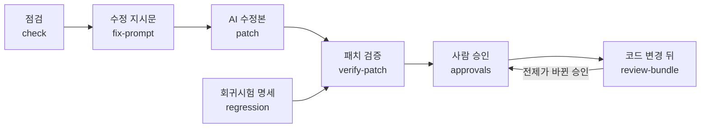

# AI가 고친 코드의 검증과 승인 근거

AI가 고친 코드를 받아들일 때 **무엇을 확인했고 무엇을 확인하지 못했는지**를 기록으로 남기는 기능들의 동작, 안전 장치, 측정 결과입니다.

> '통과'는 정한 검사 조건을 채웠다는 뜻입니다. 코드가 안전하다는 보증도, 취약점이 없다는 증명도, 수정 전후 동작이 같다는 증명도 아닙니다.
> 기록에 붙는 해시는 기록이 바뀌었는지 알아채는 데만 쓰입니다. 코드가 안전한지, 승인자가 실제 그 사람인지는 해시로 알 수 없습니다.

## 흐름



- AI가 스스로 내린 평가는 입력으로 받지 않습니다. 결과에는 도구가 직접 실행하고 잰 값만 담습니다.
- 원본 수정, 커밋, 게시, 병합은 하지 않습니다.

## 용어

| 용어 | 뜻 |
|---|---|
| 위험 호출(싱크) | 외부 입력이 닿으면 위험한 호출. 명령 실행, 파일 경로 접근, SQL 조립 등 |
| 정제 함수 | 값을 안전하게 바꾸거나 검증하는 함수. 이스케이프, 허용 목록 검사 등 |
| 원본 / 수정본 | patch를 적용하기 전 코드 / 적용한 뒤 코드 |
| 검증 기록(Receipt) | `verify-patch`가 남기는 JSON 파일. 무엇을 실행했고 결과가 어땠는지 담습니다 |
| 판정 불가 | 필요한 검사를 실행하지 못해 통과도 실패도 정할 수 없는 상태 |

## 1. 근거 요구(계약)와 근거 장부

"점검이 끝났다"(`scan_status`)와 "요구한 근거를 채웠다"(`contract_status`)는 다른 말입니다. 지적 0건이라고 자동으로 승인되지 않습니다.

- **계약 파일**(`--contract`)은 팀이 "이런 호출에는 이런 근거가 있어야 통과"라고 정하는 파일입니다. **Python·Java·JavaScript·TypeScript의 명령 실행·파일 경로 접근·SQL 조립** 세 종류를 다룹니다. Python 밖의 언어는 값이 리터럴·상수 조건·지역 컬렉션·같은 파일 도우미의 반환값으로 정해질 때만 닫힌 값으로 보고, 그 밖은 "확인 못 함"으로 남깁니다. Python 밖의 언어에서는 DB 객체(연결·커서·템플릿·ORM)에서 부른 호출과 SQL 실행에만 쓰는 이름만 SQL 지점으로 셉니다.
- **근거 장부**(보고서의 `coverage_ledger`)는 이 세 종류의 위험 호출마다 안전 근거를 확인했는지 적은 목록입니다.

| 상태 | 뜻 |
|---|---|
| `evidence_met` 근거 확인 | 모든 입력이 상수처럼 외부 입력이 섞이지 않은 값으로 확인됐거나, 외부 입력이 닿는 것이 확인돼 지적으로 보고됐습니다. 프로그램 전체가 안전하다는 뜻은 아닙니다 |
| `unsupported` 지원 안 함 | 호출은 보이지만 규칙이 이 호출을 판정할 방법이 없습니다 |
| `unresolved` 확인 못 함 | 입력이 어디서 왔는지 알아내지 못했습니다(호출하는 곳이 없는 매개변수, 따라가지 못한 호출, 객체 속성 등). **안전으로 치지 않습니다** |
| `budget_exceeded` 상한 도달 | 다른 파일·함수를 찾아가는 횟수 상한(`limits.max_cross_file_lookups`)에 걸렸습니다 |
| `policy_excluded` 정책 제외 | 계약의 제외 경로(사유 필수)나 사유 있는 억제 주석으로 뺐습니다 |

- 안전 점수 하나로 줄여 말하지 않습니다. 찾은 위험 호출 수와 분류하지 못한 파일(`unclassified`) 수를 함께 보여 주며, 분류하지 못한 파일을 빼서 비율을 좋게 만들지 않습니다.
- `mode: report`(기본)는 확인하지 못한 곳을 모아 보여 주기만 합니다. `mode: block`은 **필수로 정한 종류**에서 막기로 한 상태(`block_on`)가 있거나 분류하지 못한 변경 파일이 있으면 실패(종료코드 1)합니다. `unresolved`를 모두 취약점으로 보거나 무조건 막지는 않습니다.
- 계약 파일 자체가 이번 변경에 들어 있으면(`--changed-since`) 수정본이 기준을 바꾼 것이므로 `policy_change_review`(기준 변경 검토)로 표시합니다.
- 위험 호출은 호출 이름으로 찾습니다. import 별칭, `getattr` 같은 동적 호출, 프레임워크가 감춘 호출은 목록에 오르지 않을 수 있습니다.
- 사용자 명세(`policies.custom_spec`)에 `policies.ledger_include_spec_points: true`를 함께 켜면 명세가 더한 위험 호출도 장부에 오릅니다. 명세가 선언한 정제 함수에 기대 안전하다고 본 호출은 근거 종류가 `declared_sanitizer`로 표시되며, 그 함수가 정말 안전한지는 사람이 확인해야 합니다.

계약 파일은 직접 씁니다(`init`은 만들지 않습니다). 최소 예시:

```yaml
# .iron-laws-contract.yml
version: 1
mode: block            # report(기본): 모아 보여 주기만 함 / block: 필수 종류의 미충족이면 실패
scope: all             # changed: --changed-since로 바뀐 파일의 호출만 판정
families:              # command / path / sql. 생략하면 셋 다 필수
  command: {required: true}
  path: {required: true, block_on: [unresolved, unsupported]}   # 막을 상태
  sql: {required: false}
include_tests: false
trusted_sources: [env]   # 배포하는 사람이 값을 정한다고 믿는 입력
# exclude_paths: ["legacy/*"]
# exclusion_reason: "제외 사유"   # exclude_paths를 쓰면 필수
```

```bash
iron-laws check . --contract .iron-laws-contract.yml --changed-since origin/main
iron-laws audit . --format json     # coverage_ledger: 호출별 상태·집계·해시
```

같은 코드·설정·도구라면 CLI, JSON, SARIF(`runs[].properties.coverageLedger`), 마크다운, `fix-prompt`가 같은 판정과 범위를 보여 줍니다.

## 2. 패치 검증 (`verify-patch`)

준비할 것:

- docker와 시험용 이미지(§4의 Dockerfile로 `docker build -t iron-laws-verify:py313 .`). 시험 중에는 이미지를 내려받지 않습니다(`--pull never`).
- `--finding`에는 `check` 출력의 위치를 씁니다.
- patch, 검증 기록, 승인 기록은 점검 폴더 **밖**에 두십시오. 안에 두면 원본 해시가 달라져 `--replay`로 다시 돌린 결과가 맞지 않습니다.

```bash
iron-laws verify-patch ./proj --patch fix.diff --finding IL-504@app.py:8 \
  --runner docker --image iron-laws-verify:py313 \
  --test-cmd python --test-cmd -m --test-cmd pytest --test-cmd -q -o receipt.json
iron-laws verify-patch ./proj --patch fix.diff --replay receipt.json   # 같은 입력·조건으로 새 작업 폴더에서 다시 실행
```

종료코드: `0` 모든 검사 통과, `1` 검증 실패, `2` 판정 불가·입력 오류.

검사 항목마다 결과는 `pass` 통과 / `fail` 실패 / `not_run` 실행 안 함 / `unknown` 판정 불가 중 하나입니다. 실패와 실행 안 함을 같은 값으로 합치지 않습니다.

| 항목 | 확인하는 것 |
|---|---|
| 입력 고정 | 원본·수정본 파일 내용의 해시. 커밋하지 않은 변경도 실제 파일 내용으로 고정합니다. 작업 폴더 밖을 가리키는 심볼릭 링크와 특수 파일은 위험으로 기록합니다 |
| patch 안전성 | 폴더 밖 경로·절대 경로·`.git`·훅·바이너리·심볼릭 링크 생성·크기 상한, 실제로 적용되는지 |
| 기준과 시험 고정 | 설정·계약·실행 정책·기준선·승인 기록·**원본의 시험 파일**은 patch가 바꿀 수 없습니다. 바꾸려 하면 원본 내용으로 되돌려 실행합니다 |
| 지적을 숨기는 변경 | 시험 삭제·시험 함수 감소·시험 내용 수정, skip/xfail 추가, 단언 약화, 무시 주석(`ignore`·`nosec`·`noqa` 등) 추가, 설정 완화(`disabled_rules`·`excludes`·`fail_on` 등), 기준선 재생성, `conftest.py` 같은 시험 기반 파일 변경 |
| 같은 조건의 정적 검사 | 같은 규칙·설정·상한으로 원본과 수정본을 점검합니다. 수정본이 새로 단 억제 주석은 적용하지 않습니다 |
| 대상 지적 해소 | 지적이 사라졌어도 파일 삭제·무시 주석·설정 변경이 함께 있으면 고친 것으로 인정하지 않습니다 |
| 새 지적과 확인 못 한 곳 | 실패 기준 이상의 새 지적, 늘어난 근거 장부의 공백 |
| 변경 범위 | 대상 파일을 고쳤는지, 고친 파일 수 상한, 허용한 경로 |
| 기존 시험 | 원본과 수정본을 같은 명령으로 격리 실행합니다. 원본이 이미 실패하거나, 수정본에서 시험 0건·skip 증가·통과 수 감소가 있으면 통과가 아닙니다 |
| 회귀시험 | 아래 §3 |

검증 기록에는 원본·수정본 해시, patch 해시, 도구·규칙·설정·계약·실행 정책의 해시, 실행 환경(이미지 ID 포함), 항목별 실행 여부·결과·시간·상한 도달 여부, 지적을 숨기는 변경, 지적·공백 비교가 들어갑니다. 프롬프트 원문, 전체 소스, 전체 로그는 저장하지 않으며 시험 출력은 끝부분만 비밀을 가려 남깁니다.

기본값은 시험 실행 **필수**입니다. 격리 환경을 얻지 못하면 시험을 실행하지 않고 `판정 불가`로 남깁니다. `--no-require-tests`로 완화할 수 있지만 그 경우에도 "실행 안 함"이 기록에 남습니다.

## 3. 결함을 가려내는 회귀시험 (`regression`)

정적 지적이 사라졌다고 결함 동작이 사라진 것은 아닙니다. 회귀시험은 공격 입력을 실제로 넣어 결함 동작이 없어졌는지 봅니다.

```bash
iron-laws regression propose ./proj --finding IL-504@app.py -o spec.yml   # 초안. confirmed: false로 나옵니다
# 사람이 payload·benign·expect·fake_sink를 확인하고 confirmed: true로 바꿉니다
iron-laws regression check ./proj --patch fix.diff --spec spec.yml --runner docker --image ...
iron-laws verify-patch ./proj --patch fix.diff --finding ... --regression spec.yml
```

- **지원 범위**: Python의 명령 실행(IL-504)·경로 접근(IL-502)·SQL 조립(IL-501)이며, 대상은 **모듈에 바로 정의된 함수**(요청 값이나 매개변수가 입력)입니다. 클래스 메서드, async 함수, Django·FastAPI 처리기, 전역 DB 연결 객체를 쓰는 함수는 이유와 함께 초안을 만들지 않습니다.
- **실행 방식**: 사람이 `confirmed: true`로 바꾼 명세만 실행합니다. 시험 실행기는 실제 셸·네트워크·작업 폴더 밖 파일·DB에 접근하지 않고, 위험 호출(`os.system`·`subprocess`·`open`·DB 커서 등)을 가짜로 바꿔 호출 내용을 **기록만** 합니다.
- **확인 순서**:
  1. 원본에서 결함 때문에 실패합니다(세 번 돌려 같은 결과).
  2. 정상 입력은 원본에서 통과합니다.
  3. 수정본에서 공격 입력이 막히고 정상 입력은 계속 통과합니다(세 번 돌려 같은 결과).
  4. 수정한 부분을 되돌리거나 추가한 문장을 지운 코드에서 다시 실패합니다. 다시 실패하면 `killed`, 통과하면 `survived`, 실행할 수 없으면 `invalid`입니다.
- **결함 재현으로 세지 않는 것**: import 오류·의존성 누락·문법 오류 같은 환경 실패. 정상 입력까지 막는 수정(기능을 통째로 끄는 것)도 정답이 아닙니다. 원본에서 결함이 재현되지 않거나 의미 있는 되돌린 코드가 없으면 시험 후보로만 남기고 통과로 치지 않습니다.
- **변형 입력**: 명세의 `input.variants`는 같은 결함을 건드리는 다른 공격 입력입니다(명령: `&&`·`|`·`$()`·백틱, 경로: 절대 경로·깊은 `../`, SQL: 따옴표 없는 `1 OR 1=1` 등). 기본 입력이 통과한 뒤에도 원본에서 재현되는 변형 입력이 수정본에서 재현되면 `fail`입니다. 수정이 시험 입력 하나만 막았다는 뜻입니다. 원본에서도 재현되지 않는 변형은 건너뛰고 `evidence.variants.inapplicable`에 남깁니다. 제안된 변형 목록은 사람이 확인합니다.
- 시험 입력과 기대 결과는 **취약한 원본 코드와 종류별 공격 입력 목록**에서 만들고, 수정본 코드에서 베끼지 않습니다. 판정은 수정본을 실제로 실행해 가짜 위험 호출에 기록된 내용으로만 합니다. 정적 분석 결과를 단언으로 쓰는 시험은 만들지 않습니다.
- **결과 봉인**: 실행마다 도구가 새 봉인값을 만들어 harness에 건네고, harness는 수정본을 불러오기 전에 그 값을 읽고 지운 뒤 출력 함수를 잡아 둡니다. 도구는 봉인값이 붙은 결과 줄만 받아들입니다. 수정본이 결과 줄을 흉내 내거나 표준 출력·`os.write`를 바꾸면 결과가 없는 것으로 보고 통과시키지 않습니다.
- **기록 장치 우회 감지**: 명령 실행 계열은 판정 전에 공격 입력 끝에 카나리아 명령(실행마다 다른 이름의 파일 생성)을 붙여 한 번 따로 부릅니다. 판정은 원래 공격 입력으로 합니다. 수정본이 기록 장치 대신 `posix.system`처럼 실제 셸을 부르면 카나리아 파일이 생기고, 도구가 실행이 끝난 뒤 밖에서 확인해 결함 재현(`fail`)으로 판정합니다.
- 기록 장치는 공개 함수뿐 아니라 저수준 경로(`posix.system`, `os.open`·`posix.open`, `io.FileIO`, `_io.open`, `sqlite3.dbapi2`·`_sqlite3`)에도 걸려 있습니다.
- **한계**: 같은 프로세스의 메모리를 뒤져 봉인값을 꺼내는 조작, `ctypes`로 시스템 호출을 직접 부르는 조작, 카나리아 파일을 만든 뒤 지우는 조작처럼 검증기를 겨냥한 의도적인 조작은 막지 못합니다. `survived`는 수정과 무관하거나 동작이 같은 변경일 수 있어 사람이 봐야 합니다.

## 4. 격리 실행

저장소, patch, 시험, 주석, AI 출력, 로그는 모두 믿지 않는 입력으로 다룹니다.

| 경계 | 통제 |
|---|---|
| 원본과 수정본 | 원본은 읽기 전용, 수정본은 별도 임시 폴더. 기준 파일·원본 시험·승인 기록은 수정본이 쓸 수 없는 곳에 둡니다 |
| 실행 환경 | docker(`--network none`, 읽기 전용 루트, `--cap-drop ALL`, `no-new-privileges`, 비특권 사용자 65534, `--pids-limit`, CPU·메모리 상한) 또는 bubblewrap. 작업 폴더 하나만 마운트합니다(홈 폴더·SSH agent·클라우드 자격증명·Docker 소켓 없음) |
| 네트워크·의존성 | 시험 중 네트워크 없음. 이미지는 `--pull never`이므로 미리 받아 둡니다 |
| 명령 | 허용한 명령 목록(argv)만 실행합니다. 셸 문자열·`sh -c`는 거부합니다 |
| 자원 | 수정본마다 기본 2 CPU·2 GiB·180초·출력 1 MiB, 실행기 오류일 때만 한 번 더 시도. 상한에 걸리면(`timeout`/`output_limit`/`resource_limit`) 시험 실패가 아니라 `판정 불가`입니다 |
| 격리 실패 | **호스트에서 대신 실행하지 않습니다.** 시험을 실행하지 않고 `판정 불가`로 끝냅니다 |
| 정리 | 임시 작업 폴더를 지운 결과는 검증 기록의 `environment.workspace_cleanup`에 남깁니다. 컨테이너 중단·삭제는 합쳐서 10초 안에 시도합니다. 정리에 실패해도 검증 결과를 통과로 바꾸지 않고, 원래 생긴 오류를 가리지도 않습니다 |

네트워크 접속, 작업 폴더 밖 쓰기, `docker.sock`·`~/.ssh` 탐색, 포크 폭탄, 메모리 폭주, 무한 대기, 출력 폭주, 로그에 심은 지시문을 넣은 시험에서 모두 차단되거나 상한에 걸려 끝났고, 판정은 종료코드로만 정해졌습니다(`tests/test_stage3_verify.py`의 docker 시험).

컨테이너만으로 완전한 격리를 보증하지는 않습니다. 위험도가 높은 코드에는 microVM 같은 추가 격리를 검토하십시오. Windows·macOS용 격리 실행은 지원하지 않습니다.

시험용 이미지 예:

```dockerfile
FROM python:3.13-slim
RUN pip install --no-cache-dir pytest
```

이미지, 허용 명령, 상한은 원본 저장소의 `.iron-laws-runner.yml`에서 읽습니다.

## 5. 승인 기록 (`approvals`)

```bash
iron-laws approvals add . --finding IL-504@app.py --reason "관리자 전용·입력 검증됨" --reviewer 홍길동 \
  --expires 2027-03-31 --receipt receipt.json --minutes 12 --store /trusted/path/approvals.jsonl
iron-laws check . --approvals /trusted/path/approvals.jsonl          # 유효한 승인만 받아들임
iron-laws approvals status .   --store ...                            # 승인별 상태
iron-laws approvals queue .    --store ...                            # 검토할 승인 목록
iron-laws approvals stats      --store ...                            # 검토에 든 시간
```

승인 상태: `valid` 유효 / `needs_review` 다시 볼 것 / `resolved` 지적이 사라짐 / `unobserved` 확인 못 함 / `revoked` 철회 / `invalid` 기록 검증 실패.

- 승인은 기준선(이미 있던 지적 목록)과 **별개**입니다. 기준선 항목은 사람의 승인으로 바뀌지 않습니다(`baseline migrate`도 `kind: debt`로만 옮깁니다).
- 승인 기록에 남는 것: 사유, 대상(규칙·경로·함수·지문), 유효기간, 승인 당시 계약·설정·규칙·도구의 해시, 검토한 흐름(입력·전달·위험 호출의 위치와 변수 이름), 승인 전제의 지문, 검증 기록 해시, 검토 시간. **코드 원문과 비밀값은 담지 않습니다.**
- 승인 전제의 지문: 흐름에 있는 함수의 본문(주석·공백 제외, 데코레이터 포함), 흐름이 부르는 프로젝트 함수(깊이 3)의 본문, 그 함수를 부르는 곳의 목록, 정제·검증 호출, 위험 호출에 들어가는 문자열 상수(접근 범위·질의 틀).

코드가 바뀐 뒤 처리:

| 변화 | 처리 |
|---|---|
| 줄 이동·공백·주석·독스트링 | 유지 |
| 파일 이동 | 옛 경로가 사라졌고 새 경로와 일대일로 맞을 때만 유지 |
| 위험 코드 복사 | 원본이 남아 있는 동안 복사본은 승인을 물려받지 않음(새로 검토) |
| 새로 부르는 곳, 입력·위험 호출·부르는 함수·정제 함수 변경, 접근 범위 변경 | 그 승인만 다시 검토 |
| 규칙 판정 방식(`version`)·계약·점검 설정 변경, 유효기간 경과, 철회 | 다시 검토 |
| 파일 없음·읽기 실패 | 해소로 보지 않고 확인 못 함 |

- **같은 이름의 함수**: 부르는 곳과 불리는 함수는 `경로::이름`으로 구분합니다. 다른 파일의 같은 이름 함수(예: 같은 `handle` 처리기)가 새로 부르면 새로 부르는 곳으로 봅니다.
- **호출 대상을 알 수 없는 호출**: `getattr`·`eval`·`handlers[name](...)`·호출 결과의 호출이 흐름 안에 있으면 승인 기록에 표시합니다. 이번 변경에 그 대상이 될 수 있는 다른 Python 파일이 있으면 영향 없음으로 보지 않고 다시 검토합니다. 변경 정보가 없으면 승인은 유지하되 검토 묶음의 "남은 공백"에 표시합니다.
- 영향 판단은 구문 구조와 호출 요약으로 보수적으로 합니다. 의미가 같은지 증명하지 않습니다. Python 외 언어는 같은 파일 안의 호출만 봅니다.

### 기록 파일

- 추가만 하는 JSONL이며 각 줄이 앞 줄의 해시를 이어받습니다(`approvals verify`로 확인). 기록이 바뀌었는지 알아채는 용도입니다.
- 검토자 이름(`--reviewer`)은 본인 확인을 거치지 않은 표기입니다. 누가 승인했는지 확인하려면 `approvals add --sign-key <OpenSSH 개인키>`로 서명하고, 점검 때 `--allowed-signers <허용 서명자 목록>`을 주십시오. 서명이 틀린 승인은 `invalid`입니다. `--require-signed-approvals`를 더하면 서명 없는 승인도 `invalid`입니다. 서명 이름공간은 `iron-laws-approval`이며 검증 기록 서명(`iron-laws-receipt`)과 섞이지 않습니다.
- 서명은 승인 내용(대상·사유·전제·정책)을 인증합니다. 순번과 앞 기록 해시는 서명 대상이 아니라서 보존기간 정리(`approvals prune`)로 사슬을 다시 이어도 서명이 유지됩니다.
- 해시 사슬과 서명만으로는 기록 끝부분 삭제, 이전 파일로 되돌리기, 사슬 전체 재작성을 알아채지 못합니다. `approvals checkpoint -o <파일> --sign-key <키>`로 기록 수와 마지막 해시를 서명해 기록을 고칠 수 있는 사람이 바꿀 수 없는 곳에 두고, `approvals verify --allowed-signers <목록> --checkpoint <파일>`로 대조하십시오. 체크포인트 뒤에 더한 기록은 정상입니다. 보존기간 정리 뒤에는 체크포인트를 새로 만드십시오.
- 기록 파일은 patch가 쓸 수 없는 곳에 두십시오. 저장소 안에 있으면 `verify-patch`가 원본 내용으로 되돌려 실행하고 지적을 숨기는 변경으로 표시합니다.
- `check`·`audit`·`approvals status|verify|prune`·검토 묶음은 모두 같은 검사(해시 연결, 줄마다 유효기간·생성 시각·승인 ID·대상·정책·사유 형식)를 씁니다. 하나라도 틀린 승인은 `invalid`로 표시하고 쓰지 않으며, 파일 전체의 해시 연결이 깨졌으면 모든 승인이 `invalid`입니다.
- 지우기: `approvals forget`은 삭제 표시를 남깁니다. `approvals prune --before DATE --yes`는 만료·철회·삭제 표시된 승인 가운데 `--before` 이전에 만든 것을 파일에서 지우고 해시 연결을 새로 만듭니다. 되돌릴 수 없으며, 깨진 기록은 정리하지 않습니다.
- 검토 판단을 동의 없이 모으거나 외부로 보내지 않습니다.

### 검토 묶음 (`review-bundle`)

`iron-laws review-bundle . --approvals ...`는 코드 변경 뒤 확인할 것을 한 묶음으로 만듭니다: 바뀐 전제, 승인마다 유지·무효·판정 불가와 이유·근거 ID, 해야 할 일, 남은 공백, 다시 실행하는 방법. AI 요약이 아니라 기록된 근거에서 만들며 같은 입력이면 같은 결과가 나옵니다.

- 승인 5개 중 2개만 영향을 받으면 다시 볼 이유 2개와 유지하는 이유 3개가 모두 나옵니다.
- 승인 당시 계약·설정이 지금과 다르면 다시 볼 대상입니다. 규칙 집합·도구 버전이 다르면 "바뀐 전제"에 표시하되, 규칙별 `version`이 바뀐 승인만 다시 보게 합니다.
- 종료코드: `0` 할 일 없음, `1` 할 일 있음, `2` 점검 불완전·입력 오류.

### 시범 운영 기록 (`pilot`)

팀이 오철칙을 썼을 때 검토 비용이 실제로 줄었는지 재는 로컬 기록입니다.

```bash
iron-laws pilot assign PR-1 --team A      # 이 PR을 어떤 조건으로 검토할지 배정
iron-laws pilot record PR-1 --minutes 12  # 검토 뒤 걸린 시간 기록
iron-laws pilot summary                   # 집계
```

- 같은 PR을 두 조건에 모두 배정하지 않습니다. 팀·난이도별로 두 건마다 두 조건이 한 번씩 나오고 순서만 무작위입니다.
- 주 지표는 총 작업 시간(검토 + 추가 작업)이고, 검토 시간만 따로 본 값은 보조 지표입니다. 표본이 모자라면 판정하지 않습니다.
- 위험 사건은 확인된 잘못된 승인, 조사 중, 정당한 예외로 나눕니다. 조사 중인 사건이 있으면 판정은 `investigation_pending`입니다.
- 다른 하위 명령: `flag`(위험 사건 기록), `close`(조사 종료), `dropout`(중도 이탈).
- `--metrics`는 건수·시간·식별 해시만 한 줄로 남깁니다(경로·코드·메시지 없음, 기본 꺼짐).

## 6. 측정 결과와 한계

표본에서 0건이 나와도 실제 오류율이 0이라는 뜻은 아닙니다. 같은 사례를 바꾼 변형은 독립 표본으로 세지 않습니다. 아래 측정은 호스트에서 시험을 돌리는 시험 전용 실행기로 했으므로 격리 실행의 성능과 안전은 포함하지 않습니다.

재현 명령:

```bash
uv run python benchmarks/plan_experiments.py        # 6.1
uv run python benchmarks/plan_experiments_v13.py    # 6.2
```

### 6.1 근거 장부·패치 검증·회귀시험·승인 기록

| 항목 | 표본 | 결과 |
|---|---|---|
| 근거 장부 | 알려진 공백 30 / 안전한 변경 30 | 공백 30개 모두 드러남, 안전한 변경을 막은 경우 0/30 |
| 회귀시험 | 재현 가능한 결함 30(지원하는 모양 21, 지원 밖 9) | 시험 초안 생성 21/30, 올바른 수정 21/21 통과, 잘못된 수정 105개 중 통과 0 |
| 패치 검증 | 올바른 수정 30 / 경고만 숨긴 수정 30 / 기능을 망가뜨린 수정 30 | 올바른 수정 30/30 통과, 숨긴 수정 통과 0/30, 망가뜨린 수정 통과 0/30 |
| 승인 기록 | 안전한 이동·리팩터링 30 / 위험한 전제 변경·복사 30 | 불필요한 재검토 0/30, 위험한 승인 승계 0건 |

### 6.2 보고서 모순 검사·변형 사례집·검토 묶음

| 항목 | 표본 | 결과 |
|---|---|---|
| 보고서 모순 검사 | 정상 보고서 96개, 일부러 망가뜨린 보고서 31종 | 정상 보고서 거부 0/96, 망가뜨린 31종 모두 검출 |
| 정상·위험 코드 구별 | 개발용 30쌍(원본 60·변형 360), 평가용 15쌍(원본 30·변형 180) | 위험 놓침 0, 정상 차단 0, 의미를 바꾸지 않는 변형에서 판정 바뀜 0. 정상 사례가 확인 필요로 나온 경우 개발용 42/210, 평가용 7/105 |
| 회귀시험의 결함 구별 | 시험 입력 하나만 막는 수정 27개 | 변형 입력이 있는 명세에서 통과 0/27, 없는 명세에서 19/27 통과 |
| 코드 변경 뒤 승인 처리 | 승인 5개 × 영향 조합 30가지(150건) | 위험한 승계 0건, 불필요한 재검토 0건, 재검토 75건(전부 다시 보는 방식이면 150건) |

개발용 사례는 엔진을 고칠 때 보는 사례이고, 평가용 사례는 엔진 조정에 쓰지 않는 사례입니다([ACCURACY.md](ACCURACY.md) §4.1).

수정이 만든 부채 표시는 통과·실패에 쓰지 않습니다. 중복 함수 규칙(ARC-204)의 기준(토큰·줄 수)보다 짧은 함수의 복사는 잡지 않습니다. 원시 결과는 `docs/benchmark_results/`에 있습니다.

### 6.3 확인하지 못한 것

- 전문가가 분류한 독립 표본
- 여러 팀이 참여한 시범 운영(목표: 총 작업 시간 중앙값 20% 감소, 75백분위 악화 없음, 확인된 잘못된 승인 0, 설치 30분 이내)
- Windows·macOS에서의 격리 실행, microVM 수준의 격리
- Python 외 언어의 계약·근거 장부·회귀시험
- 자동 patch 생성과 PR 게시
